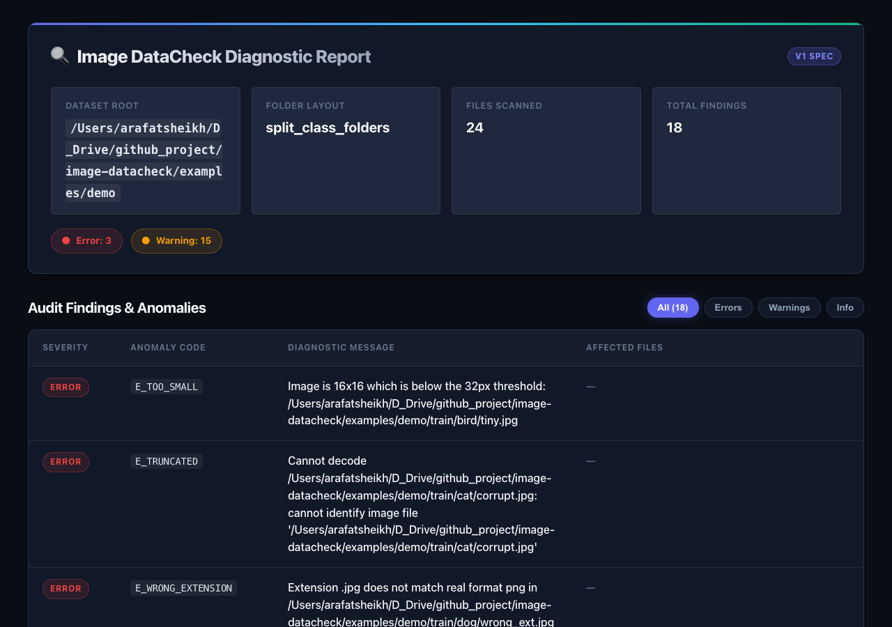
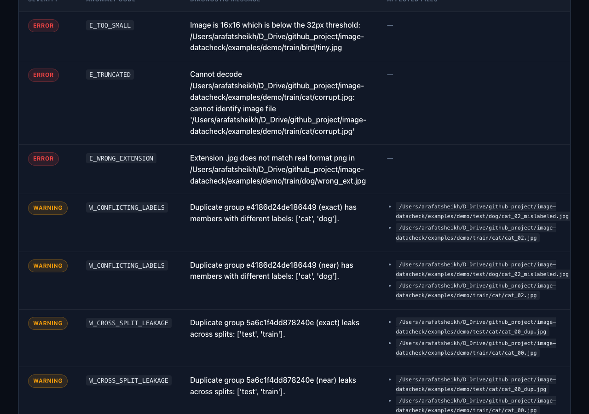

# imagedatacheck

A fast, trustworthy CLI that scans an image dataset folder and reports
data-quality problems before training: corrupt files, duplicates, class
imbalance, leakage between train/val/test splits and conflicting labels.

* **Zero dependencies at runtime** beyond Pillow, imagehash and Jinja2.
* **Standalone HTML reports** — no JavaScript, no external requests, all
  paths HTML-escaped.
* **Deterministic output** — same input always gives the same JSON, so
  reports diff cleanly.
* **Cross-platform** — tested on Ubuntu, Windows and macOS in CI.

## Screenshots & HTML Reports

| Standalone HTML Quality Audit Report | Data-Quality Findings & Duplicate Grouping |
| :---: | :---: |
|  |  |

## Quick start

```bash
pip install imagedatacheck
imagedatacheck scan /path/to/dataset
imagedatacheck report /path/to/dataset --html report.html --json report.json
```

## What it checks

| Check | Severity | Description |
| --- | --- | --- |
| Corrupt / zero-byte / truncated files | error | File cannot be decoded as an image. |
| Decompression bomb | error | Image is too large to decode safely. |
| Extension mismatch | error | File extension does not match the real format. |
| Too small | error | Image is below the `--min-size` threshold. |
| EXIF orientation present | info | Orientation tag not auto-applied. |
| CMYK / palette-with-transparency | info | Lossy or non-standard mode. |
| Low information | warning | Near-constant image; excluded from duplicate grouping. |
| Exact duplicates | warning | Two or more files with identical SHA-256. |
| Near duplicates | warning | Perceptual hash within `--phash-threshold` Hamming distance. |
| Cross-split leakage | warning | The same image in `train/` and `test/`. |
| Conflicting labels | warning | The same image in two different classes. |
| Class imbalance | warning | Largest / smallest class ratio ≥ `--imbalance-ratio`. |
| Class-name collisions | warning | `"Rose"`, `"rose "` and `"ROSE"` are the same class. |
| Empty classes | warning | A class folder has no images. |

## Layouts supported

* `split_class_folders` — `root/{train,val,test}/<class>/*.jpg` (auto-detected)
* `class_folders` — `root/<class>/*.jpg` (auto-detected)
* `flat` — `root/*.jpg`, no labels (auto-detected; class-based checks skipped)

Use `--layout {auto,class_folders,split_class_folders,flat}` to force a
specific layout.

## CLI

```
imagedatacheck scan PATH [OPTIONS]
imagedatacheck report PATH [OPTIONS]
```

### `scan` options

| Flag | Default | Description |
| --- | --- | --- |
| `--workers N` | `1` | Worker processes (`1` disables multiprocessing). |
| `--layout` | auto | Force a specific layout. |
| `--extensions` | jpg, jpeg, png, bmp, gif, tif, tiff, webp | Comma-separated extensions. |
| `--follow-symlinks` | off | Follow symbolic links. |
| `--quiet` | off | Suppress progress output. |
| `--min-size` | `32` | Min image width/height. |
| `--imbalance-ratio` | `10.0` | Class-imbalance threshold. |
| `--phash-threshold` | `4` | Hamming distance for near-duplicate detection. |
| `--rotation-invariant` | off | Match rotated and flipped copies. |
| `--no-near-duplicates` | off | Skip near-duplicate detection. |
| `--fail-on {error,warning,never}` | `error` | Fail level for the exit code. |

### `report` options

All `scan` flags plus:

| Flag | Default | Description |
| --- | --- | --- |
| `--html PATH` | — | Write HTML report to this path. |
| `--json PATH` | — | Write JSON report to this path. |
| `--thumbnails N` | `50` | Max number of embedded base64 thumbnails (`0` disables). |

### Exit codes

| Code | Meaning |
| --- | --- |
| `0` | No findings at or above the `--fail-on` threshold. |
| `1` | At least one finding at or above the threshold. |
| `2` | Usage or runtime error (e.g. empty dataset, missing path). |

## JSON schema

Reports carry a `schema_version` so downstream consumers can guard
against breakage. See [`docs/json_schema.md`](docs/json_schema.md) for
the full schema and the list of documented finding codes.

## Performance

Measured on a 2023 MacBook Pro (Apple M2 Pro, 12 cores), Python 3.12,
with the full M3 + M4 pipeline (layout detection, walk, integrity,
exact + near-duplicate detection):

| Stage | 20,000 small images |
| --- | --- |
| Wall time | **≈ 2.5 s** |
| Peak RSS delta | **26 MB** |

Re-run with:

```bash
python scripts/measure_20k.py
```

## Using it in CI

```yaml
- name: Scan dataset
  run: |
    pip install imagedatacheck
    imagedatacheck scan ./data --fail-on warning
```

`imagedatacheck scan` exits non-zero when the dataset has any
issue at or above the `--fail-on` threshold, so it can be wired into
a CI step that fails the build on bad data.

## Development

```bash
git clone https://github.com/example/imagedatacheck
cd imagedatacheck
pip install -e .[dev]
pytest -q
ruff check .
mypy src/imagedatacheck
```

## Contributing

Bug reports and pull requests are welcome. For larger changes please
open an issue first to discuss the design.

## License

MIT — see [`LICENSE`](LICENSE).
